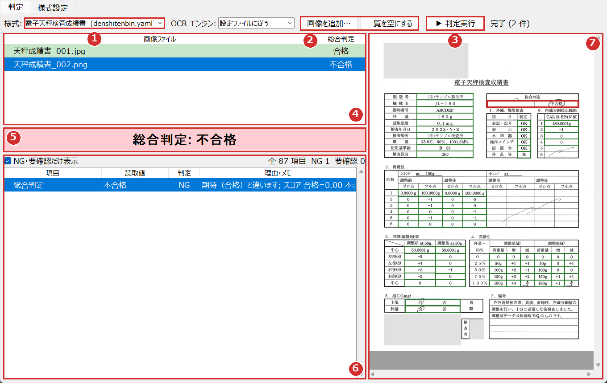
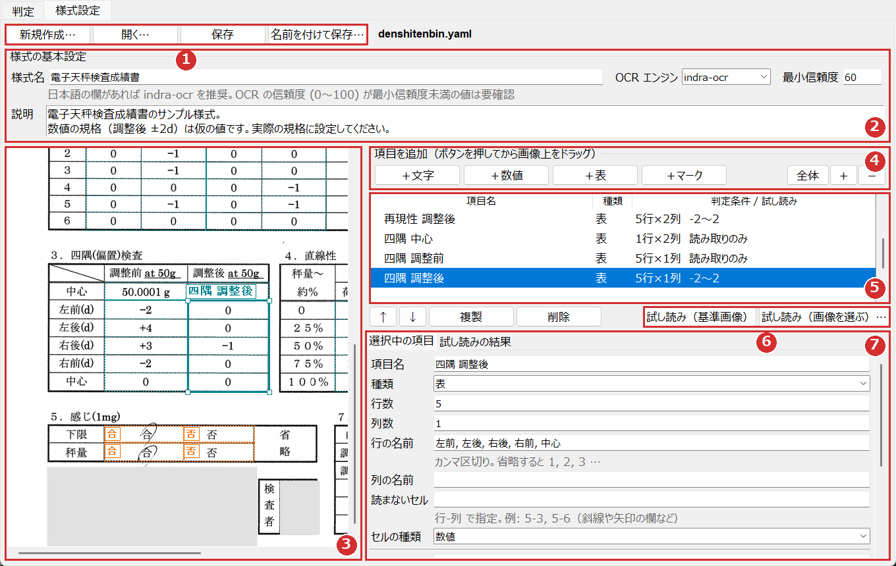
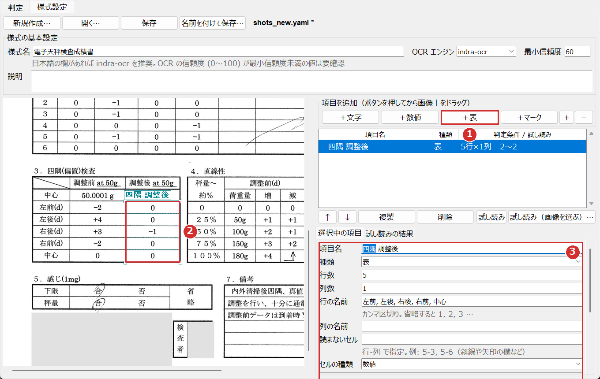
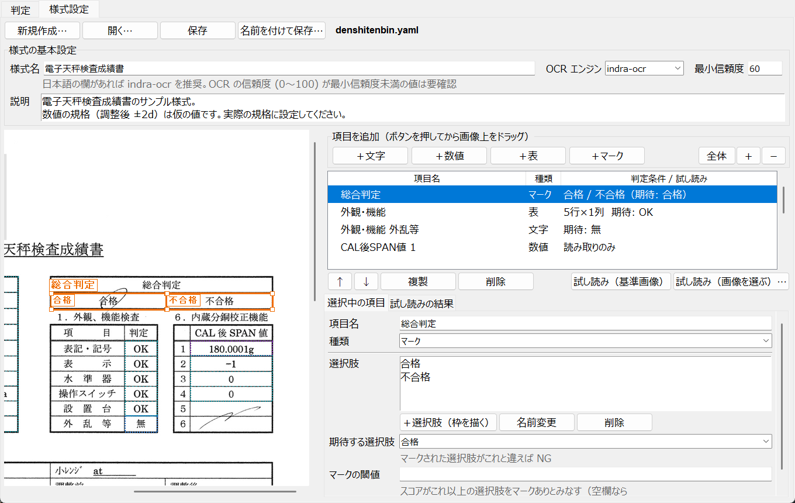
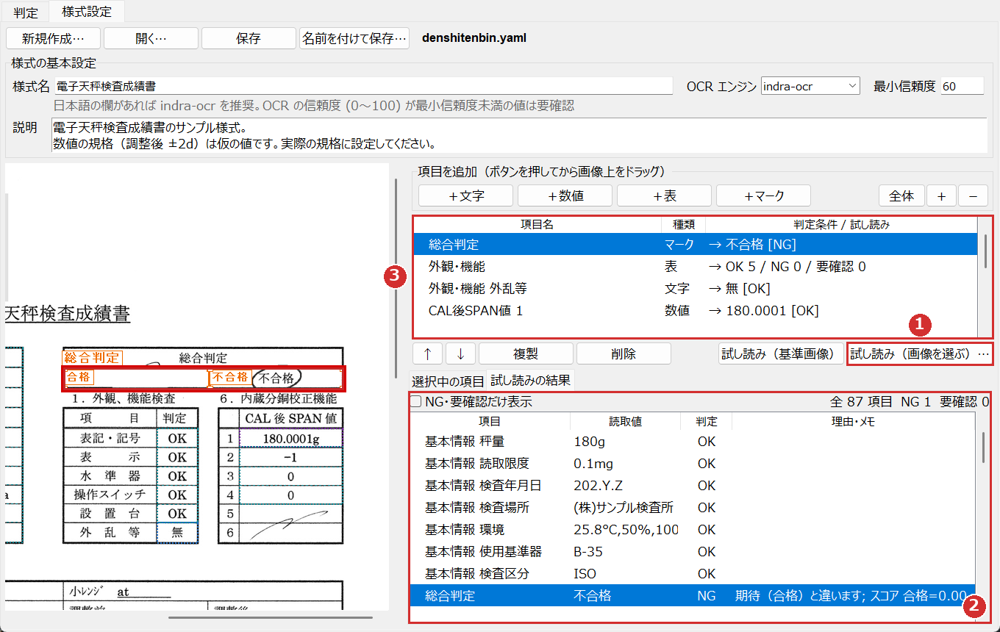
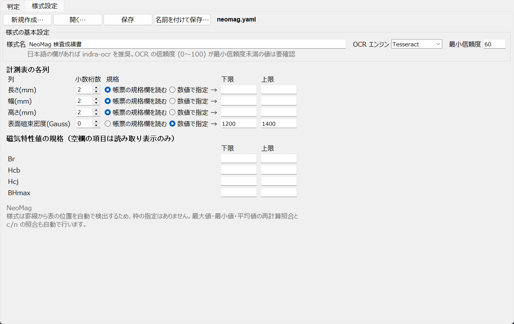
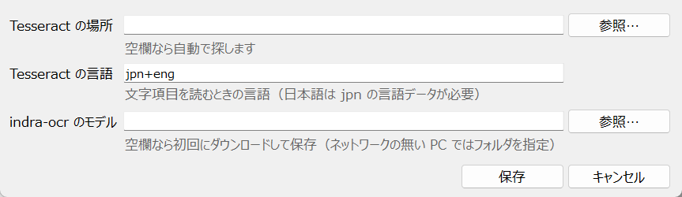

# 検査成績書 OCR 良否判定

検査成績書の画像から計測値を OCR で読み取り、規格に対する良否を判定するツールです。

検査成績書は社外秘のため、クラウドの AI サービスは使わず、**すべてこの PC 上で処理**します。画像が外部に送信されることはありません。

## できること

- 書類の様式ごとに**設定ファイル（様式）を切り替えて**読み取る
- 様式の作成・編集から判定の実行まで、**GUI だけで操作**できる（プログラムの知識は不要）
- 読み取った値が規格内か判定する（OK / NG）
- OCR の読み誤りの疑いがある値を「要確認」として知らせる
- 総合判定（合格 / 不合格 / 要目視確認）を表示する（コマンドラインでは終了コードでも返す）

様式は 2 種類あります。

| 種類 | 対象 | 読み取り位置の決め方 |
| --- | --- | --- |
| 汎用様式 | どんな書類でも（例: `sample/denshitenbin_kensa_seisekisho01.jpg` の電子天秤検査成績書） | GUI で基準画像の上に枠を描いて指定。読み取る画像は基準画像に自動で位置合わせする |
| NeoMag 専用 | `sample/inspection_sample.gif` と同じ様式 | 罫線から自動検出。最大値・最小値・平均値の再計算照合など専用のチェックあり |

同梱の様式（`configs/` フォルダ）:

| ファイル | 様式 |
| --- | --- |
| `configs/neomag.yaml` | NeoMag 検査成績書（NeoMag 専用） |
| `configs/denshitenbin.yaml` | 電子天秤検査成績書（汎用様式。基準画像は `configs/denshitenbin.jpg`） |

## セットアップ

### 1. uv

Python 環境は [uv](https://docs.astral.sh/uv/) で管理しています。

```powershell
uv sync
```

`.venv` が作られ、必要なパッケージがすべて入ります（GUI 起動用の `OCR判定.bat` も初回に自動で実行します）。

### 2. OCR エンジン

2 種類から選べます。どちらもローカルで動きます。

| エンジン | 準備 |
| --- | --- |
| indra-ocr | `uv sync` で導入済み。初回実行時にモデル（約 76MB）を Hugging Face からダウンロードし、以降はキャッシュを使うため通信しない |
| Tesseract | 本体を別途インストール: `winget install UB-Mannheim.TesseractOCR`。日本語の欄を読むにはインストール時に Japanese の言語データも追加する |

**日本語を含む書類は indra-ocr を推奨します**（電子天秤のサンプルでは indra-ocr は全項目を正しく読み約 1 秒、Tesseract は 13 項目が要確認になり約 12 秒でした）。

ネットワークにつながらない PC で indra-ocr を使う場合は、別の PC でダウンロードしたモデルフォルダをコピーし、GUI の「ファイル → 共通設定」（`settings.yaml` の `indra_model_dir`）で指定してください。

## GUI の使い方

`OCR判定.bat` をダブルクリックすると起動します（コマンドでは `uv run ocr_gui.py`）。

画面は 2 つのタブに分かれています。

| タブ | 使う場面 |
| --- | --- |
| 判定 | 毎日の作業。検査成績書の画像を読み取って合否を確認する |
| 様式設定 | 新しい種類の書類に対応させるとき、規格値を変えるとき |

### 判定タブ — 検査成績書を判定する



1. **様式**：書類の種類を選びます（`configs` フォルダの設定ファイルが一覧に出ます）。
2. **画像を追加…**：検査成績書の画像を選びます。複数まとめて選べます。「一覧を空にする」でやり直せます。
3. **▶ 判定実行**：読み取りと判定を始めます。1 枚あたり indra-ocr で約 1 秒、Tesseract で十数秒かかります。
4. **画像ファイルの一覧**：ファイルごとの総合判定が色付きで出ます（緑 = 合格、赤 = 不合格、橙 = 要目視確認、灰 = 読み取りエラー）。行をクリックすると、そのファイルの結果に切り替わります。
5. **総合判定**：選んだファイルの判定結果です。
6. **項目の一覧**：項目ごとの読取値・判定・理由です。NG は赤、要確認は橙の背景になります。「NG・要確認だけ表示」にチェックを入れると、問題のある項目だけに絞れます。
7. **画像**：読み取った位置が判定結果の色の枠で表示されます（汎用様式のみ）。一覧の行をクリックすると、その項目の枠が太く表示され、見える位置までスクロールします。

上の例では、2 枚目の画像で「総合判定」欄の「不合格」に○が付いているため、期待値（合格）と違うとして NG になっています。

**判定結果の見方**

| 総合判定 | 意味 | すること |
| --- | --- | --- |
| 合格 | すべての項目が規格内で、読み誤りの疑いもない | なし |
| 不合格 | 規格外の値（NG）がある | NG の項目を確認する |
| 要目視確認 | 読み誤りの疑いがある項目（要確認）が 1 つ以上ある | 「理由・メモ」を見て、原本と突き合わせる |
| 読み取りエラー | 選んだ様式と違う書類、または画像が不鮮明 | 様式の選択と画像を確認する |

マウスのホイールで画像を上下に、Shift + ホイールで左右にスクロールできます。Ctrl + ホイールで拡大・縮小します。

### 様式設定タブ — 画面の見方

既存の様式を「開く…」で開いた画面です。



1. **ファイル操作**：新規作成・開く・保存・名前を付けて保存。変更があるとファイル名の後ろに `*` が付きます。
2. **様式の基本設定**：様式名（判定タブの一覧に出る名前）、OCR エンジン、最小信頼度、説明。
3. **基準画像**：読み取り項目の枠が色付きで表示されます（青 = 文字、紫 = 数値、水色 = 表、橙 = マーク）。選んだ項目は太線になり、表は行・列の区切りが点線で表示されます。
4. **項目を追加**：「＋文字」「＋数値」「＋表」「＋マーク」を押してから、基準画像の上をドラッグして枠を描きます。右側のボタンで拡大・縮小、「全体」で画像全体を表示します。
5. **項目の一覧**：登録した項目と判定条件です。行をクリックすると、その枠に移動します。
6. **試し読み**：今の設定で実際に読んでみます。「基準画像」か、別の画像を選べます。
7. **選択中の項目**：選んだ項目の名前と判定条件を設定します。入力した内容はすぐに反映されます（数値の欄に数値以外を入れると文字が赤くなり、反映されません）。

### 新しい様式を作る

新しい種類の書類（例えば別のメーカーの検査成績書）を読めるようにする手順です。

**① 新規作成**

1. 「新規作成…」を押し、**記入済みの検査成績書の画像**を 1 枚選びます。これが「基準画像」になります。
2. 様式名（例: `電子天秤検査成績書`）を入力します。
3. 保存先を聞かれるので、`configs` フォルダのまま保存します。基準画像も同じフォルダにコピーされます。

基準画像は、実際に読み取る書類と同じ様式で、なるべくまっすぐ・高解像度のものを選んでください。読み取る画像の傾き・位置ずれ・拡大縮小は、判定のときに自動で補正されます。

**② 読み取りたい欄を枠で囲む**



1. 項目の種類のボタン（例では「＋表」）を押します。
2. 基準画像の上で、読み取りたい欄をドラッグして囲みます。表は表全体（見出しを除いた値の部分）を囲むと、罫線から行数・列数が自動で設定されます。
3. 右下の欄で、項目名と判定条件を入力します。例では行の名前を「左前, 左後, 右後, 右前, 中心」、下限 `-2`、上限 `2`、小数桁数 `0` にしています。

枠を描いた後は、枠の中をドラッグで移動、角の白いつまみで大きさの変更、Delete キーで削除ができます。描くのをやめるときは Esc キーを押します。

**項目の種類と判定条件**

| 種類 | 使う欄の例 | 判定条件 |
| --- | --- | --- |
| 文字 | 機種名、OK/NG を書く欄 | 「期待する値」（例: `OK`）に一致すれば OK、「NG とする値」（例: `NG`）に一致すれば NG、どちらでもなければ要確認。両方空欄なら読み取って表示するだけ |
| 数値 | 計測値 1 つ | 下限・上限（ちょうど境界の値は合格）。「小数桁数」が違えば読み誤りとみなして要確認。「単位」（`g` など）を指定すると取り除いて読む。下限・上限とも空欄なら表示するだけ |
| 表 | 同じ条件の値が並んだ表 | 各セルを数値（または文字）として、同じ条件で判定する。斜線や矢印で値が無い欄は「読まないセル」に `行-列`（例: `5-3`）で指定して除外する |
| マーク | 手書きの○で選ぶ欄（合格/不合格、合/否 など） | 下で説明 |

- 文字欄と数値欄の「空欄でもよい」にチェックを入れると、何も書かれていなくても要確認になりません。
- 表のセルに `↑`・`〃`・`同上` と書かれていた場合は、上のセルと同じ値として判定します。
- 条件が違う列が混ざった表（例: 「荷重量」と「増・減」）は、列ごとに別の表として登録してください。

**③ 手書きの○で選ぶ欄（マーク）**



1. 「＋マーク」を押し、1 つ目の選択肢（例: 「合格」の欄）を囲みます。選択肢の名前を聞かれるので入力します。
2. 続けて 2 つ目の選択肢（例: 「不合格」の欄）を囲み、名前を入力します。3 つ以上ある場合は続けて囲みます。終わったら Esc キーを押します。
3. 「期待する選択肢」で、合格のときに○が付くはずの選択肢を選びます。

○が期待と違う選択肢に付いていれば NG、どこにも付いていない・複数に付いている場合は要確認になります。○が欄からはみ出していても検出できるので、枠は欄に合わせて描いてください。

**④ 試し読みで確認する**



1. 「試し読み（基準画像）」または「試し読み（画像を選ぶ）…」を押します。上の例は、「不合格」に○が付いた別の画像で試し読みしたところです。
2. 「試し読みの結果」に全項目の読取値と判定が出ます。行をクリックすると、該当の枠が赤で強調されます。
3. 項目の一覧にも、項目ごとの結果（表は OK・NG・要確認の件数）が出ます。

読み取りがおかしい項目があれば、枠の位置や大きさ、判定条件を直して、もう一度試し読みします。マークの判定が不安定な場合は、理由・メモ欄の「スコア」を見て、「マークの閾値」を調整してください（○がある選択肢のスコアより小さく、無い選択肢のスコアより大きい値にします）。

**⑤ 保存する**

「保存」を押すと設定ファイルに保存され、判定タブの「様式」の一覧に追加されます。

### NeoMag 様式の規格を変える

`configs/neomag.yaml` を開くと、枠ではなくフォームで設定します。表の位置は罫線から自動で検出されるため、枠の指定はありません。



- **計測表の各列**：小数桁数と規格。規格は「帳票の規格欄を読む」か「数値で指定」を選びます。
- **磁気特性値の規格**：下限・上限を入れた項目だけ判定します。空欄の項目は読み取って表示するだけです。

### 共通設定

メニューの「ファイル → 共通設定…」で、この PC で使う OCR エンジンの場所を設定します（`settings.yaml` に保存されます）。通常は空欄のままで動きます。



## コマンドラインでの使い方

```powershell
uv run inspection_ocr.py sample/inspection_sample.gif                         # NeoMag 様式（既定）
uv run inspection_ocr.py sample/denshitenbin_kensa_seisekisho01.jpg --config configs/denshitenbin.yaml
uv run inspection_ocr.py scans/a.gif scans/b.gif --engine indra               # 複数ファイル、エンジン指定
uv run inspection_ocr.py scans/a.gif --debug                                  # 読み取り位置を debug/ に画像出力
```

> `python inspection_ocr.py ...` で実行するとシステムの Python が使われ、indra-ocr が見つかりません。`uv run` を使うか、先に `.venv\Scripts\Activate.ps1` で `.venv` を有効にしてください。

| オプション | 内容 |
| --- | --- |
| `--config パス` | 様式の設定ファイル（省略時は `configs/neomag.yaml`） |
| `--engine tesseract\|indra` | OCR エンジン（省略時は設定ファイルの `engine`） |
| `--debug` | 読み取った位置を枠で描いた画像を `debug/` に保存 |

### 出力例（NeoMag 様式）

```text
ファイル : sample\inspection_sample.gif  (OCR: indra)
ロットNo.: NN14092301

磁気特性値: Br=10.44  Hcb=9.92  Hcj=22.49  BHmax=26.05

     No.      長さ(mm)        幅(mm)      高さ(mm)         Gauss
    規格     19.9-20.1      9.9-10.1     1.95-2.05     1200-1400
----------------------------------------------------------------
       1         20.02         10.03          1.99          1310
       ...
     c/n          0/20          0/20          0/20          0/20
(NG=規格外, ?=要確認)

■ 総合判定: 合格
```

汎用様式では「項目 / 読取値 / 判定」の一覧を表示します。NG や要確認があると、「■ 指摘事項」に理由が一覧表示されます。

```text
■ 指摘事項
  [NG] 総合判定: 不合格 - 期待（合格）と違います; スコア 合格=0.00 不合格=2.41
  [要確認] 四隅 調整後 右後: =| - 数値として読めません ('=|')

■ 総合判定: 要目視確認
```

### 終了コード

| コード | 意味 |
| --- | --- |
| 0 | 合格 |
| 1 | 不合格（NG あり、要確認なし） |
| 2 | 要目視確認（要確認が 1 件でもある） |
| 3 | 読み取りエラー（表の構造を検出できない、基準画像と位置合わせできない、エンジンが見つからない） |

複数ファイルを指定した場合は、最も悪い結果のコードを返します。

## 設定ファイル

通常は GUI で編集すれば十分です。GUI で保存すると、ファイル内のコメントは消えます。

### settings.yaml（PC 共通）

```yaml
tesseract_cmd: null        # null なら自動検出
tesseract_lang: jpn+eng    # 文字項目を Tesseract で読むときの言語
indra_model_dir: null      # null なら初回ダウンロード＆キャッシュ
```

### configs/neomag.yaml（NeoMag 専用）

```yaml
type: neomag
name: NeoMag 検査成績書
engine: tesseract          # tesseract / indra
min_confidence: 60         # これ未満の OCR 信頼度は要確認

columns:
  length: {decimals: 2, spec: from_document}
  width:  {decimals: 2, spec: from_document}
  height: {decimals: 2, spec: from_document}
  gauss:  {decimals: 0, spec: {min: 1200, max: 1400}}

magnetic: {}               # 例: Br: {min: 10.0, max: 11.0}
```

- `spec: from_document` は帳票の「検査規格」欄を読み取って使います。`{min: .., max: ..}` を書くとそちらが優先されます。
- **Gauss の規格は帳票に「N極中心」としか書かれていないため、初期値 1200〜1400 は仮の値です。実際の規格に設定してください。**
- 磁気特性値は規格を設定した項目だけ判定し、未設定の項目は読み取り結果の表示のみです。

### configs/denshitenbin.yaml（汎用様式の例）

```yaml
type: template
name: 電子天秤検査成績書
reference_image: denshitenbin.jpg   # 基準画像（設定ファイルと同じフォルダ）
engine: indra
min_confidence: 60
fields:
- name: 外観・機能 外乱等
  kind: text                        # text / number / table / mark
  box: [821, 652, 894, 689]         # 基準画像上の枠 [左, 上, 右, 下]（ピクセル）
  expect: [無]
  ng_values: [有]
- name: 四隅 調整後
  kind: table
  box: [370, 1215, 535, 1400]
  rows: 5
  cols: 1
  row_labels: [左前, 左後, 右後, 右前, 中心]
  min: -2
  max: 2
  decimals: 0
- name: 総合判定
  kind: mark
  options:
  - {label: 合格, box: [652, 372, 915, 409]}
  - {label: 不合格, box: [916, 372, 1157, 409]}
  expect: [合格]
```

**電子天秤様式の数値の規格（調整後の再現性・四隅・直線性・SPAN 値を ±2d）は、帳票に書かれていないため仮の値です。GUI の様式設定で実際の規格に設定してください。** 調整前の値・荷重量・基本情報は読み取り表示のみにしています。

## 判定の仕組み

### NeoMag 専用

1. **表構造の検出** — 罫線を検出し、3 か所の二重罫線（「測定値」行の下 / No.20 の下 / c/n の下）を基準に各行・各列の位置を求めます。スキャン時の位置ずれには追従しますが、様式が変わると検出できません。
2. **OCR** — Tesseract はセルごとに、indra-ocr はページ全体を 1 回読んで各行をセルに割り当てます。
3. **良否判定** — 規格の範囲内なら OK、外れたら NG。
4. **読み誤りの検出** — 次の場合はその値を「要確認」にします。
   - 数字以外の文字が混じっている、小数桁数が設定と違う
   - OCR の信頼度が `min_confidence` 未満
   - indra-ocr で、1 行が隣のセルまでつながって読まれた
   - 読み取った 20 値から再計算した最大値・最小値・平均値が、帳票の値と合わない
   - 帳票の c/n と、判定した NG 件数が合わない

### 汎用様式

1. **位置合わせ** — 読み取る画像と基準画像の特徴点（ORB）を対応づけ、射影変換で基準画像の座標に合わせます。一致する点が少ない（別の様式の画像など）場合は読み取りエラーにします。
2. **OCR** — 枠の位置で各項目を読みます（表は罫線に沿ってセルに分割）。
3. **良否判定と読み誤りの検出** — 数値は書式（数字以外の文字、小数桁数）と信頼度、文字は期待値との一致で判定します。期待値と違う文字は「NG とする値」に一致しない限り NG ではなく要確認にし、読み誤りを NG と取り違えないようにしています。
4. **手書きマーク** — 罫線を除いた黒画素のうち、縦横とも文字 1 字分より大きい塊（○やチェックが文字とつながったもの）の面積をスコアにします。閾値（既定 0.3）以上の選択肢がちょうど 1 つならそれを選択とみなします。

要確認が 1 件でもあれば、総合判定は「要目視確認」になります。読み誤りを数字に当てはめて隠さないよう、OCR の文字種はあえて制限していません。

## エンジンの比較

NeoMag サンプル画像と、それを人工的に劣化させた画像での正読数（全 80 値中）です。

| 画像 | Tesseract | indra-ocr |
| --- | --- | --- |
| 元画像 | 80 | 80 |
| ノイズ | 38 | 76 |
| JPEG 高圧縮 | 56 | 78 |
| ぼかし | 2 | 80 |
| 0.8 倍に縮小 | 11 | 80 |
| 0.3° 傾き | 65 | 80 |

処理時間は 1 枚あたり、Tesseract が 10〜20 秒、indra-ocr が約 0.5 秒（初回はモデル読み込みで約 2 秒）でした。どの条件でも、誤読があるのに「合格」と出たケースはありませんでした。

電子天秤サンプル（汎用様式）では、回転・平行移動・縮小・射影歪み・JPEG 高圧縮・ぼかし・ノイズを加えた画像でも位置合わせとマーク判定は正しく、判定に使う値の誤読はすべて要確認になりました。

## 注意事項

- **indra-ocr のライセンス**: コードは Apache 2.0 ですが、モデルの重みは独自条件付きの OpenRAIL-M です。無償利用は研究・個人利用と、資金調達額または売上が 2,000 万ドル未満の企業に限られます。業務で使う前に、[ライセンス条件](https://huggingface.co/datalab-to/indra-ocr/blob/main/LICENSE)を確認してください。
- **見逃しの可能性**: 形式が正しく規格内に収まる誤読（例: `1310` → `1330`）は、検出できないことがあります（NeoMag 様式では最大値・最小値・平均値との照合で一部を検出します）。重要な判定では、要目視確認になったものだけでなく、定期的に原本との突き合わせを行ってください。
- **手書きマーク**: ○・チェック・斜線のように文字より大きく書かれた印を検出します。文字の横に小さく書いたチェックなどは検出できないことがあります。新しい様式では、記入パターンの異なる画像で試し読みし、スコアを見て閾値を調整してください。
- 基準画像（`configs/` 内の画像）と `--debug` で出力した画像は検査成績書の内容を含みます。取り扱いに注意し、`debug/` は不要になったら削除してください。

## テスト

```powershell
uv run pytest tests
```

両方の様式のサンプル画像を読み、正解値との一致、規格外の値を NG にすること、読み誤りを要確認にすること、劣化・位置ずれ画像での位置合わせ、手書きマークの判定、別様式の画像を拒否することを確認します（Tesseract 未導入の場合、Tesseract のテストはスキップされます）。

## ライセンス

このツールのコードは [Apache License 2.0](LICENSE) で提供します（Copyright 2026 Tomohiro Kusu）。

サンプル画像・基準画像に写っている帳票の内容と、OCR エンジン（indra-ocr のモデルの重み、Tesseract）や依存パッケージはこのライセンスの対象外で、それぞれの権利者の条件に従います。詳しくは [NOTICE](NOTICE) を参照してください。

## ファイル構成

```text
LICENSE                  ライセンス（Apache-2.0）
NOTICE                   著作権表示と第三者の著作物について
OCR判定.bat              GUI の起動（ダブルクリック）
docs/images/             README 用のスクリーンショット
ocr_gui.py               GUI（判定タブ・様式設定タブ）
inspection_ocr.py        コマンドライン ＋ NeoMag 専用の読み取り・判定
template_ocr.py          汎用様式の位置合わせ・読み取り・判定
ocr_common.py            共通部品（設定の読み込み、OCR エンジン、数値の判定）
settings.yaml            PC 共通の設定（Tesseract の場所など）
configs/                 様式の設定ファイルと基準画像
pyproject.toml           依存パッケージ（uv）
uv.lock
tests/test_sample.py     NeoMag 様式のテスト
tests/test_template.py   汎用様式のテスト
sample/                  サンプル画像
```
